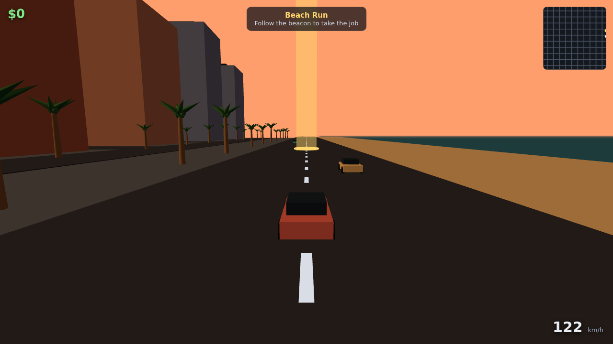
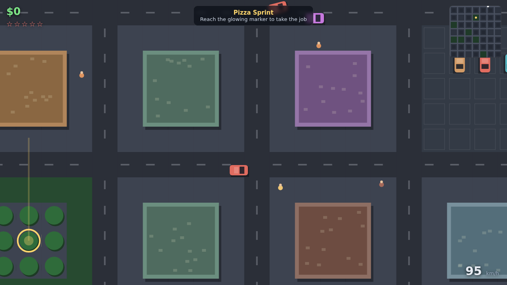

# Grand Theft Car

An open-city driving game built for the browser. Cruise a low-poly coastal city, take timed delivery jobs, and explore a separate top-down arcade mode.

Built with JavaScript, Three.js, and HTML Canvas. No package installation, build step, or backend is required.


[Getting started](#getting-started) · [Game modes](#game-modes) · [Controls](#controls) · [Project structure](#project-structure) · [Contributing](#contributing)

## Overview

The main game is a third-person driving prototype set in a procedurally generated coastal city. A palm-lined highway connects the beach to a downtown street grid, with moving traffic and a helicopter overhead.

- **Arcade driving:** accelerate, brake, reverse, and use the handbrake to drift through turns.
- **Timed deliveries:** find a job beacon, reach the destination before time runs out, and earn in-game cash.
- **Driving HUD:** follow the chase camera, check your speed, and use the minimap to find the next marker.
- **Two perspectives:** play the 3D coastal drive or explore the earlier 2D arcade prototype.
- **Static-site architecture:** serve the repository directly. Three.js is included locally in `vendor/`, with no runtime CDN dependency.

This is an actively developed prototype, not a finished driving simulator. The two modes have different features and controls.

## Getting started

### Requirements

- Git to clone the repository, or a downloaded copy of the source.
- A local static HTTP server. The example below uses Python 3.
- A browser with JavaScript and ES module support. The 3D mode also requires WebGL.

### Run locally

```bash
git clone https://github.com/DhanushNehru/grand-theft-car.git
cd grand-theft-car
python3 -m http.server 8000
```

Open **http://localhost:8000** and select **Hit the coast road** to start driving.

| Mode | Local address | Entry point |
| --- | --- | --- |
| 3D coastal drive | http://localhost:8000/ | `index.html` |
| 2D arcade prototype | http://localhost:8000/arcade.html | `arcade.html` |

Serve the files over HTTP rather than opening them with `file://`. Browser ES modules need a server. Any static HTTP server can be used in place of Python; there are no npm commands or build artifacts to generate.

## Game modes

### 3D coastal drive

The main mode focuses on driving and deliveries: a low-poly city, coastal highway, ocean, beach, traffic, and a chase camera.

1. Follow the yellow beacon on the map to a job's starting point.
2. Drive into the marker to start the timer. The destination turns green.
3. Reach the destination before the timer expires to collect the reward.
4. Continue to the next job. If time runs out, return to the starting marker to retry.

Three delivery routes cycle through the city: **Beach Run**, **Skyline Dash**, and **Palm Circuit**.



### 2D arcade prototype

The earlier top-down mode uses HTML Canvas and a seeded tile-based city. It includes on-foot exploration, entering and leaving cars, pedestrians, traffic, a police heat system, delivery missions, and synthesized sound effects.

These systems are separate from the 3D mode. On-foot movement, car entry and exit, police heat, and audio are not implemented in the 3D drive.



## Controls

| Input | 3D coastal drive | 2D arcade prototype |
| --- | --- | --- |
| `W` / `Up` | Accelerate | Move forward / accelerate |
| `S` / `Down` | Brake / reverse | Move backward / brake / reverse |
| `A` / `Left` | Steer left | Move left on foot / steer left |
| `D` / `Right` | Steer right | Move right on foot / steer right |
| `Space` | Handbrake / drift | Handbrake |
| `E` | Not used | Enter / exit a nearby car |
| `M` | Not used | Mute / unmute |

On-screen touch controls are included for touch devices. In 3D mode they provide steering, acceleration, braking/reverse, and a **DRIFT** button. Mobile layouts and handling are still being improved; a keyboard is a useful starting point for testing.

## Project structure

```text
.
├── index.html              # 3D entry point, HUD, menu, and touch controls
├── arcade.html             # 2D arcade entry point
├── style.css               # 2D interface styles
├── js/
│   ├── main3d.js           # Three.js scene, driving, traffic, and deliveries
│   ├── main.js             # 2D startup and demo parameters
│   ├── game.js             # 2D game loop, entities, audio, and missions
│   └── world.js            # Seeded world generation and collision helpers
├── vendor/
│   └── three.module.js     # Vendored Three.js module
├── docs/                   # Gameplay screenshots
├── CONTRIBUTING.md
└── LICENSE
```

Both modes use JavaScript ES modules. The 3D scene uses original low-poly geometry; the 2D mode renders to Canvas. World generation uses seeded randomness so the layout is reproducible.

## Current scope

- Single-player, local browser sessions. No account system or multiplayer service.
- Cash and mission progress are held in memory and reset when the page reloads.
- The 3D mode is silent and does not yet include a pause menu or player-to-traffic collisions.
- There is no automated test suite yet. Changes should be checked by playing the affected mode in a real browser.

## Troubleshooting

| Problem | What to check |
| --- | --- |
| Blank page after opening an HTML file | Run a static HTTP server and use the local address, not `file://`. |
| 3D scene does not appear | Check that WebGL is available in your browser and inspect the browser console for errors. The 2D mode uses Canvas instead. |
| Port 8000 is already in use | Run `python3 -m http.server 8001` and open the matching local address. |
| A control seems to be missing | Check the mode-specific controls above. The two modes do not share every feature. |

## Contributing

See [CONTRIBUTING.md](CONTRIBUTING.md) for the development workflow and project guidelines. Keep changes focused, preserve the no-build setup, and test in a real browser before opening a pull request.

Browse the [issue tracker](https://github.com/DhanushNehru/grand-theft-car/issues) for planned work. Issues labelled `good first issue` are intended as starting points for new contributors. Current areas include audio, missions, traffic, mobile controls, performance, tests, and documentation.

For a bug report, include steps to reproduce, expected and actual behavior, and your browser and device. Screenshots or a short recording help with visual problems.

## License

The project is available under the [MIT License](LICENSE). The vendored Three.js module retains its own MIT license notice.

Grand Theft Car is an unofficial, original project and is not affiliated with any existing game franchise.
