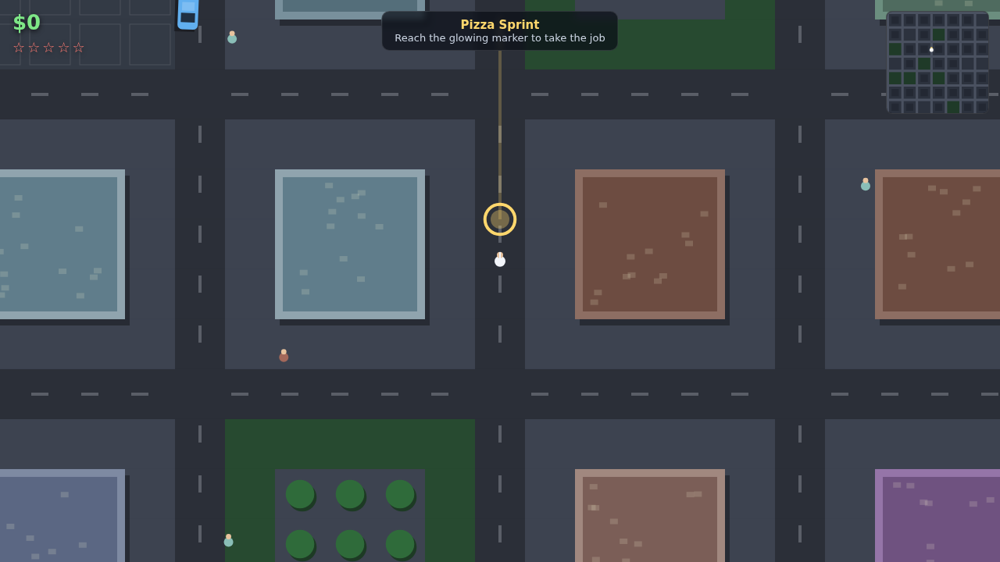

# Metro Drift

An open-city driving game that runs entirely in your browser. No installs, no build step, no accounts — open the page and hit the streets.


## Play

The game is a static site. Play it on GitHub Pages here:

**https://dhanushnehru.github.io/metro-drift/**

Or run it locally — any static file server works:

```bash
git clone https://github.com/DhanushNehru/metro-drift.git
cd metro-drift
python3 -m http.server 8000
# open http://localhost:8000
```

(ES modules need to be served over HTTP, so opening `index.html` directly from disk won't work.)

## What's in the city

- **On foot or behind the wheel** — walk the sidewalks, hop into any parked car, or "borrow" one from traffic if you're feeling reckless
- **Delivery jobs** — find the glowing marker, pick up, and beat the clock across town for cash
- **Heat system** — run people over or smash up traffic and the police come looking; lie low and it blows over
- **Living city** — traffic that keeps to its lane, pedestrians, parks, parking lots, and a procedurally generated layout that's the same city for everyone
- **Handbrake drifts** — hold Space and throw the car sideways
- **Touch controls** — playable on a phone browser too



## Controls

| Key | Action |
| --- | --- |
| `W` `A` `S` `D` / arrows | Walk / drive |
| `E` | Enter / exit a car |
| `Space` | Handbrake |
| `M` | Mute / unmute |

## How it works

Plain HTML canvas and vanilla JavaScript modules — no dependencies, no framework, no bundler. The city is generated deterministically from a seed in `js/world.js`; game logic, physics, traffic and police AI live in `js/game.js`.

## Contributing

Contributions are welcome — see [CONTRIBUTING.md](CONTRIBUTING.md). Good first issues are labelled in the issue tracker.

## License

[MIT](LICENSE)
