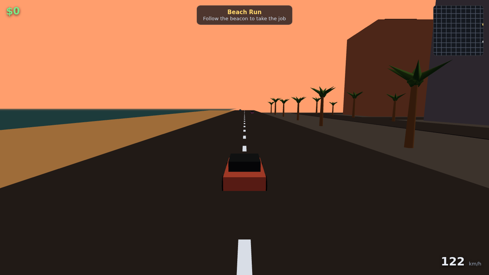

# Grand Theft Car 6

An unofficial, original open-city driving game that runs entirely in your browser. Not affiliated with any existing game franchise — all code and art are original and procedurally generated.



## Play

The game is a static site. Play it on GitHub Pages here:

**https://dhanushnehru.github.io/grand-theft-car-6/**

Or run it locally — any static file server works:

```bash
git clone https://github.com/DhanushNehru/grand-theft-car-6.git
cd grand-theft-car-6
python3 -m http.server 8000
# open http://localhost:8000
```

(ES modules need to be served over HTTP, so opening the HTML files directly from disk won't work.)

## What's in the city

- **Third-person 3D driving** (`3d.html`) — a stylized coastal city at sunset: palm-lined highway with lane dashes, beach and ocean, downtown skyline, traffic, and a helicopter circling overhead
- **Delivery jobs** — follow the glowing beacon, pick up, and beat the clock across town for cash
- **Handbrake drifts** — hold Space and throw the car sideways
- **Chase camera, minimap and HUD** — speed, cash and mission timer always in view


There is also a top-down 2D arcade prototype (`index.html`) from the first iteration: on-foot exploration, enter any parked car, police heat system, pedestrians and missions.


## Controls

| Key | Action |
| --- | --- |
| `W` `A` `S` `D` / arrows | Drive (walk in the 2D prototype) |
| `Space` | Handbrake |
| `E` | Enter / exit a car (2D prototype) |
| `M` | Mute / unmute (2D prototype) |

## How it works

- 3D mode: [Three.js](https://threejs.org/) (vendored in `vendor/`) with low-poly original geometry, chase camera and arcade car physics in `js/main3d.js`
- 2D mode: plain HTML canvas and vanilla JavaScript modules, deterministic seeded city in `js/world.js`

## Contributing

Contributions are welcome — see [CONTRIBUTING.md](CONTRIBUTING.md). Good first issues are labelled in the issue tracker.

## License

[MIT](LICENSE)
